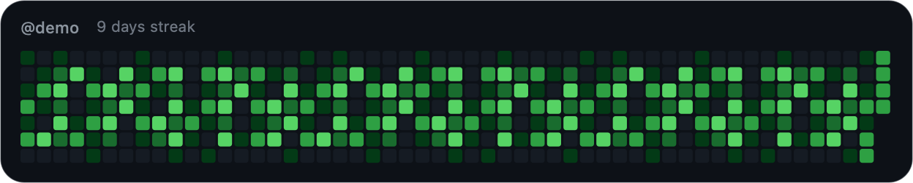
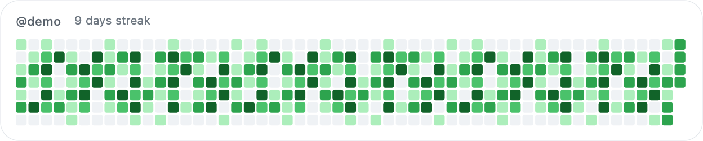

# Grove

A compact GitHub calendar for your Mac desktop: **username, current streak, and the complete contribution grid**.

*Illustrative demo data, rendered by the application. No real person's calendar is bundled.*

## Download

[Download Grove 0.2.0](https://github.com/norawly/github-grove/releases/tag/v0.2.0) — macOS 13+, Apple Silicon and Intel.

1. Open the DMG and move Grove into Applications.
2. Open Grove, enter your GitHub username, and save.
3. The card starts at the top left. Drag to reposition; it settles into a desktop grid slot.

No terminal, account registration, GitHub token, Dock icon, or menu-bar icon is needed. Reopen Grove or double-click the card to access settings. Right-click for appearance, size, refresh, position lock and Quit.

Community downloads are ad-hoc signed, **not Apple-notarized**. First launch may require System Settings → Privacy & Security → Open Anyway. [Apple's instructions](https://support.apple.com/en-us/102445).

## Minimal appearance

- GitHub's own dark/light calendar colours.
- Full rolling year, muted username and UTC streak.
- No mascot, animation loop, icon, separator, month/day labels, legend, timestamps, or status footer.
- 624 × 126 points at 100%, with four sizes.
- Snap to a desktop grid with a short 0.25-second ease-out transition. Reduce Motion disables the transition.
- Hourly refresh and a local offline calendar.
- Optional login startup, position lock and desktop-card visibility in settings.

## Native macOS widgets

The source includes a **real WidgetKit extension**, separate from the desktop card. It uses the same minimal design, the configured username, its own hourly timeline, and an offline cache. Native placement and snapping are then managed by macOS. It requires macOS 14+.

**Current limitation:** the extension compiled and registered locally, but macOS 27 rejected its ad-hoc signature when populating the widget gallery. The development machine has no Apple-issued signing identity. Therefore, the community DMG provides the compact desktop card; it must not be described as a successfully installed native WidgetKit widget.

To prepare a properly signed native build, use an Apple-issued signing identity:

~~~sh
SIGNING_IDENTITY="Apple Development: your identity" INCLUDE_WIDGET=1 bash scripts/build.sh
~~~

Developer ID signing and notarization are needed for ordinary public distribution. Once the signed extension is accepted, add Grove from macOS's Edit Widgets gallery and disable Show desktop card in Grove settings. Gallery operation is still pending a signed build; compiling an extension alone does not prove it works there. See [native-widget status](docs/native-widget.md).

## Data and privacy

Grove fetches only the public graph at https://github.com/users/USERNAME/contributions, without cookies, credentials, analytics or third-party services. It preserves your last calendar if GitHub is offline or its markup changes.

GitHub contributions include commits and other activity such as pull requests, issues and reviews. Private activity appears only if you enable anonymized private contributions on your public profile. [GitHub's explanation](https://docs.github.com/en/account-and-profile/concepts/contributions-on-your-profile).

The streak uses UTC. If today has no activity yet, yesterday's streak remains until the day ends. A plus sign marks a streak reaching the beginning of the available graph. Older offline data cannot prove today's activity.

Preferences and the last calendar are stored in ~/Library/Application Support/Grove/. To uninstall, disable Start at login, quit Grove, remove the app and optionally that folder. Local user data and diagnostics are excluded from the repository.

## Build and checks

Apple's Command Line Tools or Xcode are sufficient; no third-party dependencies are used.

~~~sh
git clone https://github.com/norawly/github-grove.git
cd github-grove
bash scripts/test.sh
bash scripts/build.sh --package
~~~

Outputs: universal app, DMG, ZIP and checksums in dist/. Building does not install or launch the app. The optional WidgetKit extension is compiled independently with bash scripts/build-widget.sh; without an Apple-issued identity this is a compilation check only.

The Swift package also supports swift run GroveChecks and swift build -c release --product Grove. Headless developer commands:

~~~sh
dist/Grove.app/Contents/MacOS/Grove --fetch octocat
dist/Grove.app/Contents/MacOS/Grove --render preview.png --theme dark
~~~

Rendering defaults to fictional demo data. --html FILE --username NAME or --cache FILE renders supplied calendar data without opening windows.

[Verification](docs/verification.md) · [Architecture](docs/architecture.md) · [MIT license](LICENSE)

Independent community project, unaffiliated with GitHub or Apple.
